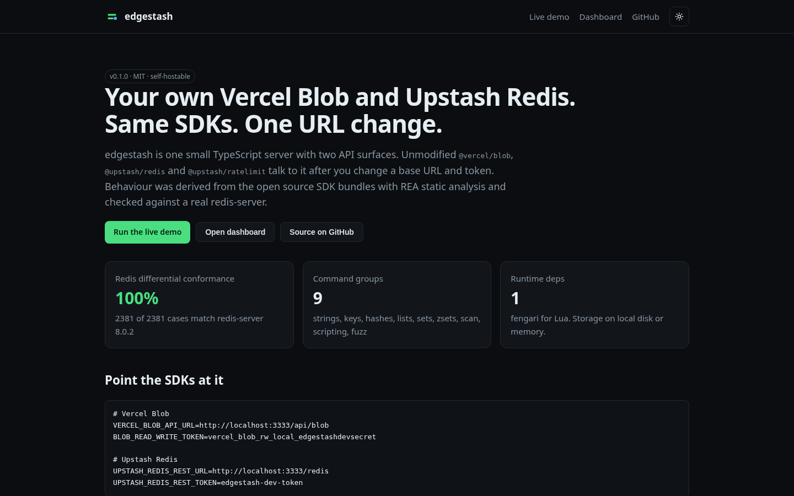
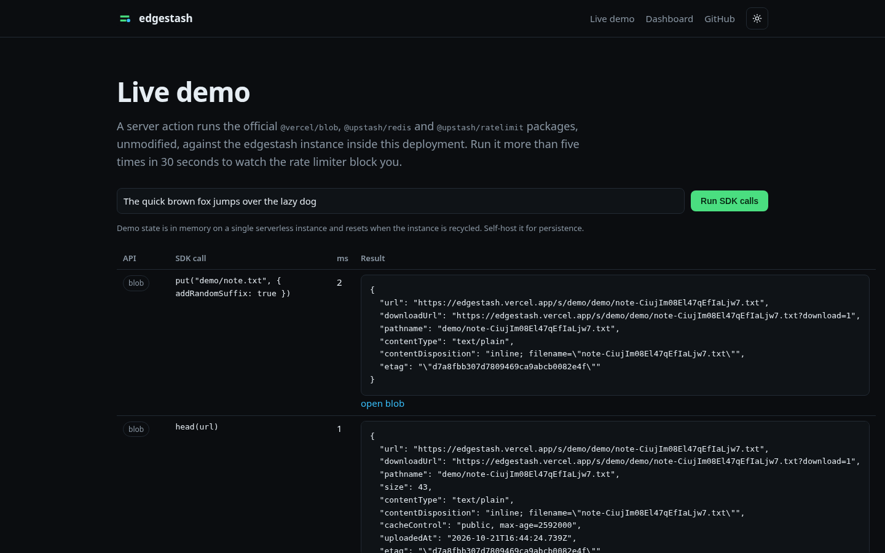
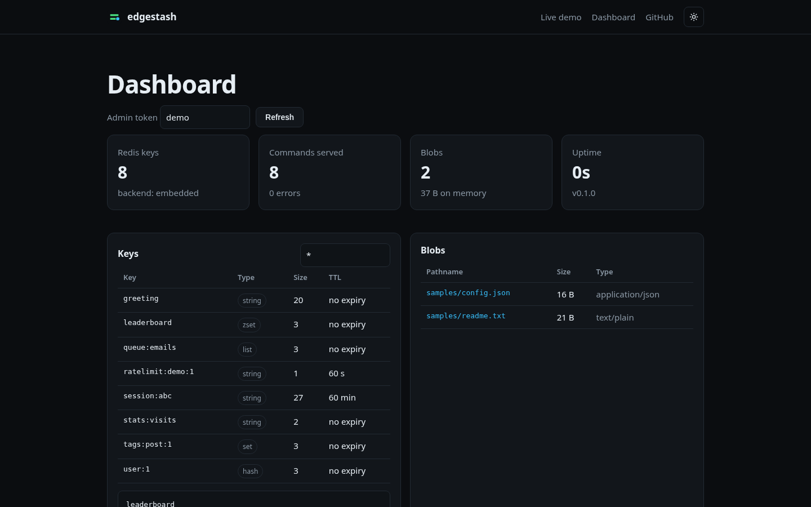
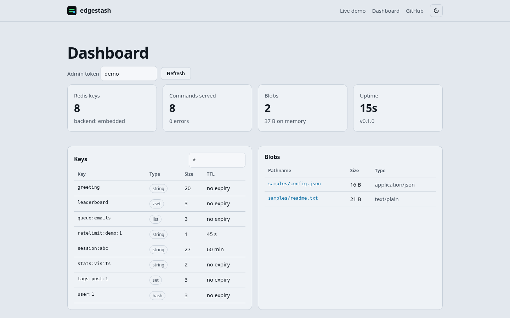

# edgestash

Self-hostable server that speaks the Vercel Blob and Upstash Redis REST APIs, so the official `@vercel/blob`, `@upstash/redis` and `@upstash/ratelimit` packages work against it after changing only a URL and a token.

[](https://edgestash.vercel.app)
[](https://github.com/devtechedge/edgestash/actions/workflows/ci.yml)


[](LICENSE)

## Live Demo

**https://edgestash.vercel.app** · [live SDK demo](https://edgestash.vercel.app/demo) · [dashboard](https://edgestash.vercel.app/dashboard)

> The hosted demo keeps its state in memory on a single serverless instance, so data resets when Vercel recycles it and the dashboard seeds sample data on an empty instance. Self-host with Docker for persistent storage.

## Screenshots

| Landing | Live SDK demo |
| --- | --- |
|  |  |
| **Dashboard** | **Light mode** |
|  |  |

## Use it

```bash
docker compose up -d
```

```bash
# Vercel Blob
VERCEL_BLOB_API_URL=http://localhost:3333/api/blob
BLOB_READ_WRITE_TOKEN=vercel_blob_rw_local_edgestashdevsecret

# Upstash Redis
UPSTASH_REDIS_REST_URL=http://localhost:3333/redis
UPSTASH_REDIS_REST_TOKEN=edgestash-dev-token
```

Your existing code stays exactly as it is:

```ts
import { put, list } from "@vercel/blob";
import { Redis } from "@upstash/redis";
import { Ratelimit } from "@upstash/ratelimit";

const { url } = await put("avatars/ada.png", file, { access: "public", addRandomSuffix: true });
const redis = Redis.fromEnv();
await redis.set("user:1", { name: "Ada" }, { ex: 60 });
const { success } = await new Ratelimit({ redis, limiter: Ratelimit.slidingWindow(10, "10 s") }).limit("ip");
```

Runnable copies live in [`examples/`](examples).

## Features

- **Blob API:** put (single and multipart), head, list with cursor and folded mode, delete, copy, rename, createFolder, `addRandomSuffix`, `allowOverwrite`, `ifMatch`, cache control, public and private blobs, Range and ETag downloads.
- **Client uploads:** `upload()` plus `handleUpload()` with HMAC client tokens, content type and size limits, expiry, and the signed `onUploadCompleted` callback.
- **Redis REST API:** single commands, path style commands, `/pipeline`, `/multi-exec`, base64 response encoding, read-only tokens, read-your-writes sync header.
- **Embedded Redis engine in TypeScript:** strings, hashes, lists, sets, sorted sets, TTLs with NX/XX/GT/LT, SCAN family, 64-bit INCR semantics, and Lua scripting (EVAL, EVALSHA, SCRIPT) for every @upstash/ratelimit algorithm.
- **Or proxy to a real Redis** with `EDGESTASH_REDIS_BACKEND=redis://...`, including a rewrite for the Upstash-only script flag that stock Redis rejects.
- **Operations:** filesystem storage, JSON snapshots, Prometheus `/metrics`, dashboard API, Docker image with healthcheck.

## Conformance

| Suite | Result |
| --- | --- |
| Differential vs real `redis-server` 8.0.2 (curated cases plus 2000 seeded fuzz commands) | **2381 / 2381 (100%)** |
| `@vercel/blob` SDK tests (server and client uploads) | 22 / 22 |
| `@upstash/redis` SDK tests, run on the embedded engine and on proxied redis-server | 30 / 30 |
| `@upstash/ratelimit` tests (fixed, sliding, token bucket, cached, deny list), both backends | 26 / 26 |
| Total Vitest tests in CI | 99 |

Per group numbers: [docs/CONFORMANCE.md](docs/CONFORMANCE.md). What is and is not covered: [docs/COMPATIBILITY.md](docs/COMPATIBILITY.md).

## How it was built

The protocol was reconstructed from the published SDK bundles, not from hosted service internals. [REA](https://github.com/morluto/rea) statically analysed `@vercel/blob`, `@upstash/redis` and `@upstash/ratelimit`, and its Evidence (hashed with SHA-256) surfaced the env overrides, every `x-*` header, the error code mapping and the full set of ratelimit Lua scripts. The findings are written up per API in [specs/blob/SPEC.md](specs/blob/SPEC.md) and [specs/redis/SPEC.md](specs/redis/SPEC.md), with digests in [evidence/](evidence).

## Stack

| Layer | Technology |
| --- | --- |
| Server | TypeScript, Node `http`, Web Fetch API handler |
| Scripting | Lua 5.3 via fengari |
| Dashboard and demo | Next.js 16, React 19 |
| Tests | Vitest, real redis-server for differential runs |
| Monorepo | pnpm workspaces, Turborepo |
| Delivery | GitHub Actions, Docker, Vercel |

## Development

```bash
pnpm install
pnpm build
pnpm test            # unit, SDK and differential suites (differential needs redis-server on PATH)
pnpm start           # http://localhost:3333
pnpm --filter web dev
pnpm conformance     # regenerate docs/CONFORMANCE.md against redis://127.0.0.1:6379
```

Configuration: [docs/CONFIGURATION.md](docs/CONFIGURATION.md). Design: [docs/ARCHITECTURE.md](docs/ARCHITECTURE.md). Known gaps: [docs/LIMITATIONS.md](docs/LIMITATIONS.md).

## License

MIT License. See [LICENSE](LICENSE). Not affiliated with Vercel or Upstash.
